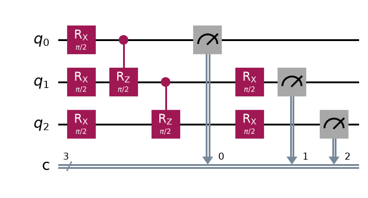
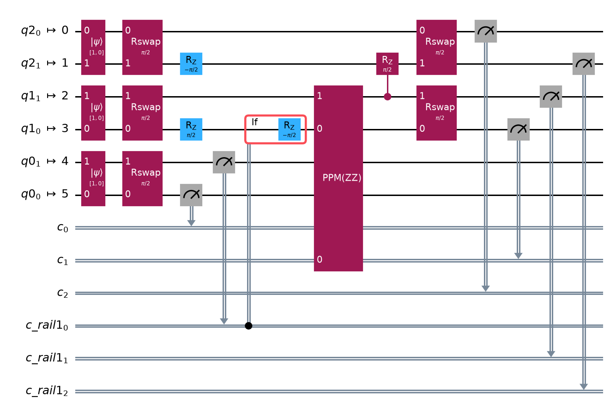

# PRISM

[](https://www.python.org/downloads/)
[](https://github.com/evmckinney9/prism/actions/workflows/ci.yml)

PRISM is a Qiskit transpiler for dual-rail qubits, where each logical qubit is a pair of physical modes (rails).
A logical gate then has several physical realizations on different rails; PRISM keeps all of them through lowering and picks one per gate while routing.

```bash
pip install git+https://github.com/evmckinney9/prism  # needs a Rust toolchain
```

## Quickstart

```python
import numpy as np
from qiskit import QuantumCircuit
from qiskit.transpiler import CouplingMap
from prism import ErasureCheck, dualrail_pm

qc = QuantumCircuit(3, 3)
qc.rx(np.pi / 2, [0, 1, 2])
qc.crz(np.pi / 2, 0, 1)
qc.append(ErasureCheck(), [1], [1])
qc.crz(np.pi / 2, 1, 2)
qc.rx(np.pi / 2, [1, 2])
qc.measure(range(3), range(3))

pm = dualrail_pm(CouplingMap.from_line(6), seed=7)
out = pm.run(qc)
print(pm.property_set["circuit_metrics"])
```

```text
CircuitMetrics(swaps=0, depth=6, active_gates=13, size=19)
```





Rails `q<i>_0` and `q<i>_1` carry logical qubit `i`.
Qubit 0 has nothing but its first `crz` before its measurement, so it is measured first and that `crz` becomes an `rz` conditioned on the bit of the control rail; the second `crz` stays.
A measurement writes rail 0, the logical bit, to `c[i]` and rail 1 to `c_rail1[i]`; both 0 means the photon was lost.
`budget=SearchBudget(objective="depth")` keeps the shallowest route found instead of the one with the fewest SWAPs.

## Gate set

| Logical | Physical, on the qubit's rails |
| --- | --- |
| `rz(θ)` | `rz(θ)` on rail 0 |
| `rx(θ)` | `rswap(θ)`, the exponential SWAP of the two rails |
| `x` | `swap` of the two rails |
| `crz(θ)` | `crz(±θ)` between any rail of the control and any rail of the target, plus `rz` for an open control: four candidates |
| `swap` | none: the logical stage relabels the qubits |
| `measure` | `measure` on both rails |
| `reset`, and preparation | `Initialize("10")` on the two rails |
| `ErasureCheck` | `PauliProductMeasurement(Pauli("ZZ"))` on the two rails: 1 if the photon is there, and the logical state is undisturbed |
| `if_else` | `if_else` on the qubit's rails |

The physical `Target` allows `crz`, `swap`, `rswap`, `initialize` and the ZZ check only on device edges, so preparation and erasure checks are local, and no Qiskit pass can produce an operation that leaves the code space.

Limits:

- The coupling map must be connected, with at least two physical qubits per logical qubit.
- `if_else` is the only control flow; its blocks hold single-qubit gates and no measurement.
- A multi-controlled X with three or more controls borrows one extra logical qubit as a clean ancilla (register `mcd_anc`), which needs far fewer gates.
- Barriers are dropped.

## Pipeline

| Stage | IR | Passes |
| --- | --- | --- |
| `logical` | `DAGCircuit` | stock passes to the logical gate set, with a dual-rail equivalence library |
| `dag_to_multi_realization` | `DAGCircuit -> MultiRealization` | each operation becomes its candidates |
| `multi_realization` | `MultiRealization` | prism's own passes (`prism.passes`): `ElideRailExchanges` drops logical X as a relabelling of its rails, then `PrismRouting` places the program and makes a choice per operation |
| `multi_realization_to_dag` | `MultiRealization -> DAGCircuit` | the choices become gates; the layout is written |
| `physical` | `DAGCircuit` | stock O3 over the dual-rail `Target`, then `EarlyMeasurement`: each rail is measured before the `rz` and `crz` behind its measurement, which become `rz` conditioned on its bit |

`prism.pipeline.prism_stages(cmap, DualRail)` returns these stages as a `MultiStagePassManager`; `dualrail_pm` nests them in a `PassManager`.
In a `MultiRealization`, each logical operation is a `MultiRealizationOp` with its `candidates` and a `choice`; only the `multi_realization_to_dag` stage turns them into gates.
Any pass that sets a `choice` on every op is a complete `multi_realization` stage; if none places the program, the physical stage lays it out and routes it with stock Qiskit:

```python
import random

from qiskit.passmanager import GenericPass
from qiskit.transpiler import PassManager
from prism.encodings import DualRail
from prism.ir import MultiRealization, MultiRealizationOp
from prism.pipeline import prism_stages


class RandomChoice(GenericPass[MultiRealization, MultiRealization]):
    def run(self, passmanager_ir: MultiRealization) -> MultiRealization:
        for ins in passmanager_ir.data:
            if isinstance(op := ins.operation, MultiRealizationOp):
                op.choice = random.randrange(len(op.candidates))
        return passmanager_ir


stages = prism_stages(CouplingMap.from_line(6), DualRail)
stages.multi_realization = [RandomChoice()]
out = PassManager([stages.to_flow_controller()]).run(qc)
```

## Development

```bash
make init  # .venv, editable install, git hooks
make test
```

Citation: TODO, once the paper is out.

> [!IMPORTANT]
> This software is provided as-is with no guarantee of support or maintenance.
> AI tools were used to assist in writing code in this repository.
> Bug reports and pull requests are welcome. For more information, see [the contribution guide](https://github.com/evmckinney9/prism/blob/main/.github/CONTRIBUTING.md).
